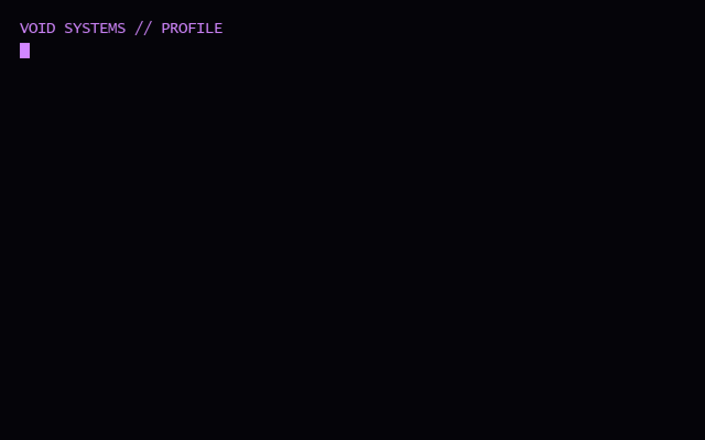
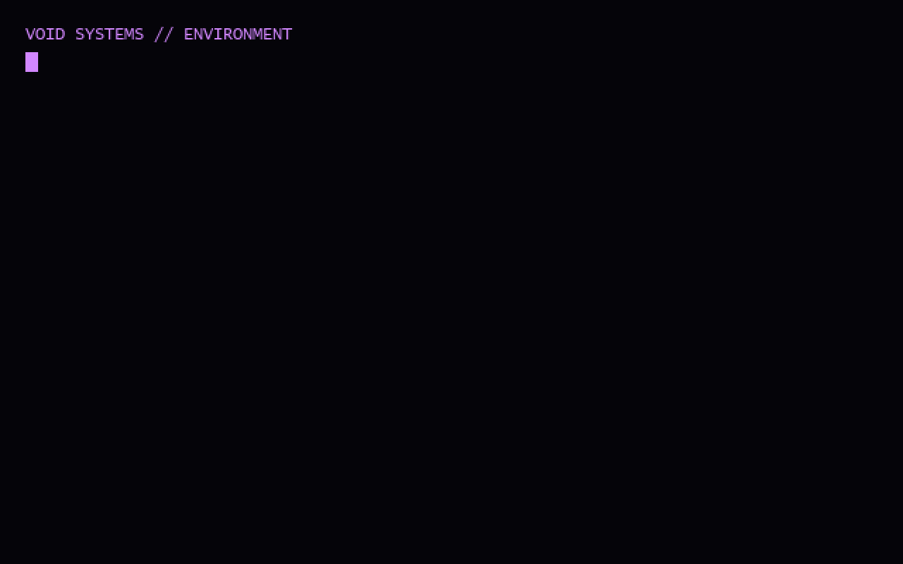
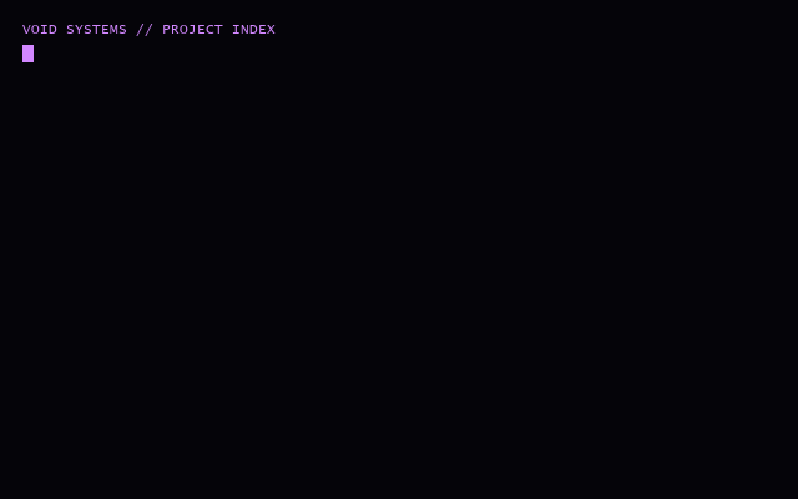
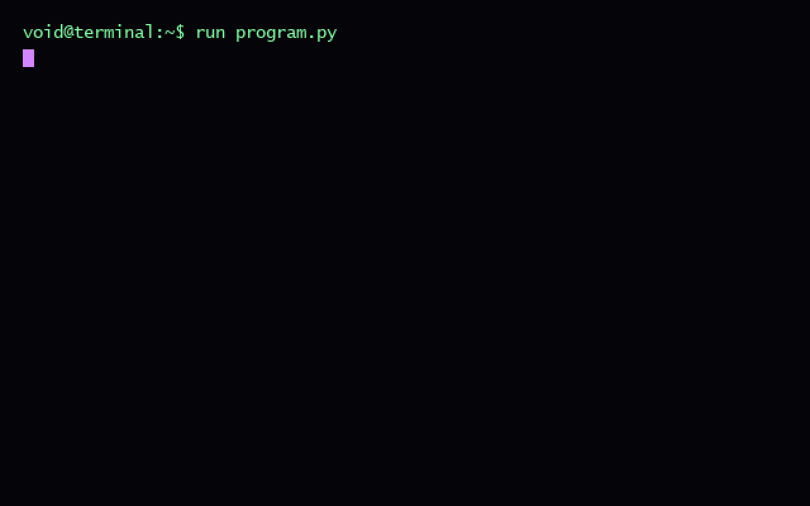
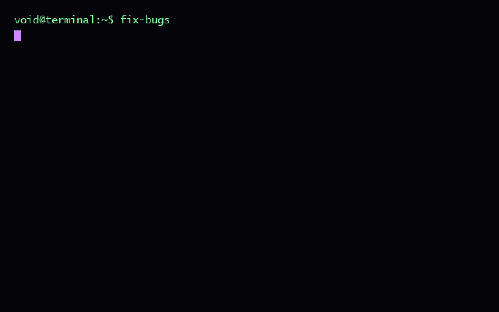
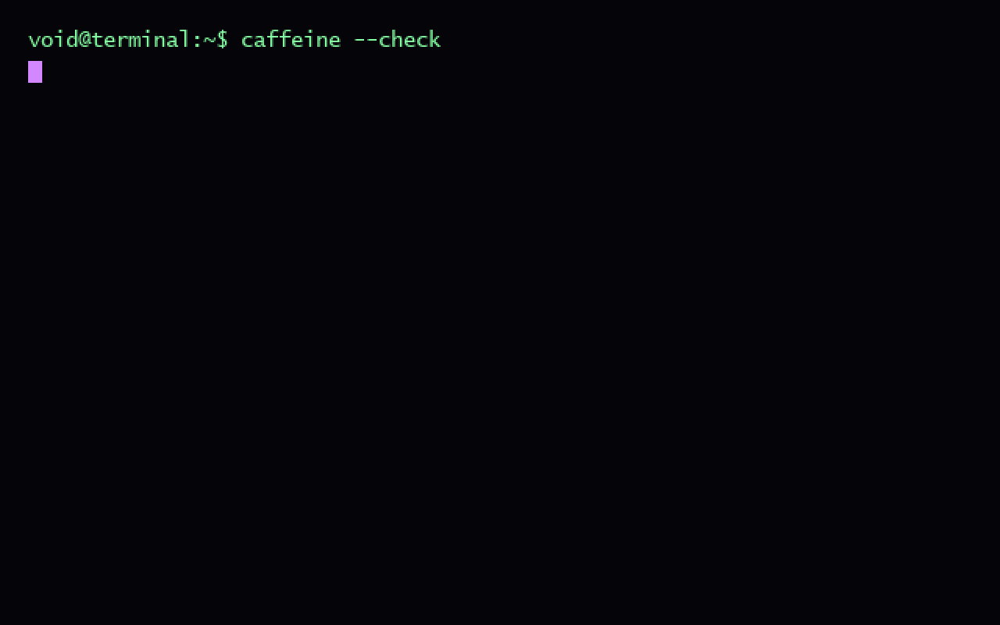
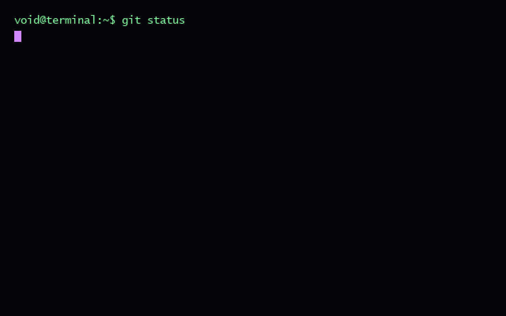
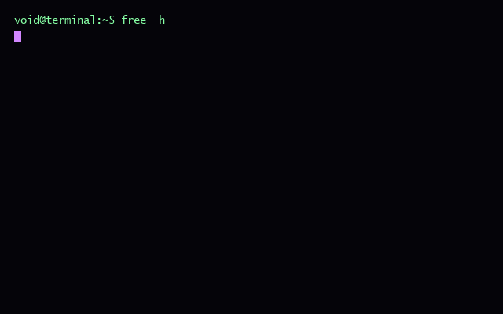

 

# VOID

**SOFTWARE DEVELOPER · SYSTEMS ENGINEERING · CYBERSECURITY**

Building software, infrastructure, and tools under **VoidWare**.

---

`01` **ABOUT**　·　`02` **TECH STACK**　·　`03` **PROJECTS**　·　`04` **STATISTICS**　·　`05` **CONNECT**

 

## `01` — About Me

I'm a developer focused on building practical software, backend infrastructure, and systems that solve real problems.

- **Application Development** — Windows desktop applications and developer utilities.
- **Backend Engineering** — APIs, authentication systems, licensing, and server infrastructure.
- **Systems Engineering** — Operating system concepts and low-level experimentation.
- **Game Infrastructure** — Multiplayer services and game revival projects.
- **Cybersecurity** — Learning security analysis, system hardening, and secure development.

---

## `02` — Tech Stack

**LANGUAGES**

**FRAMEWORKS & PLATFORMS**

**DEVELOPMENT TOOLS**

 

---

## `03` — Projects

My projects focus on practical utilities, desktop software, backend infrastructure, and automation.

### [Simple File Scanner](https://github.com/VVoidddd/Simple-File-Scanner)

A file scanning utility built to inspect files and identify potential issues.

`PYTHON` `FILE ANALYSIS` `SECURITY`

### [ZeroTrace](https://github.com/VVoidddd)

A Windows cleanup and uninstallation utility designed to find applications, remove files, and clean up leftover data.

`PYTHON` `WINDOWS` `SYSTEM UTILITIES`

### [VoidWare Tools](https://github.com/VVoidddd)

A collection of custom utilities, including file transfer software and tools for everyday development tasks.

`PYTHON` `NETWORKING` `UTILITIES`

### [Zipper](https://github.com/VVoidddd)

A desktop file management utility focused on identifying unused files and organizing storage.

`PYTHON` `PYQT` `DESKTOP DEVELOPMENT`

### [CallBot](https://github.com/VVoidddd)

A Discord bot with command management, server administration, and custom logging functionality.

`PYTHON` `DISCORD.PY` `BOT DEVELOPMENT`

---

## `04` — GitHub Statistics

 

Statistics are provided by external services. Availability and refresh intervals depend on each provider.

---

## `05` — Connect

 

 

**VOIDWARE**

*Building things worth using.*

---

### RANDOM DEVELOPER MOMENTS

 

 

